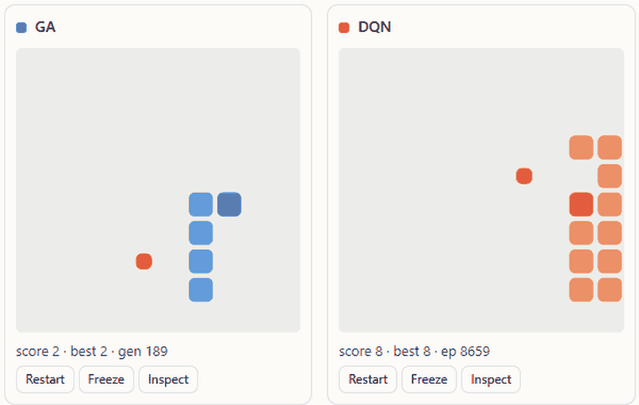
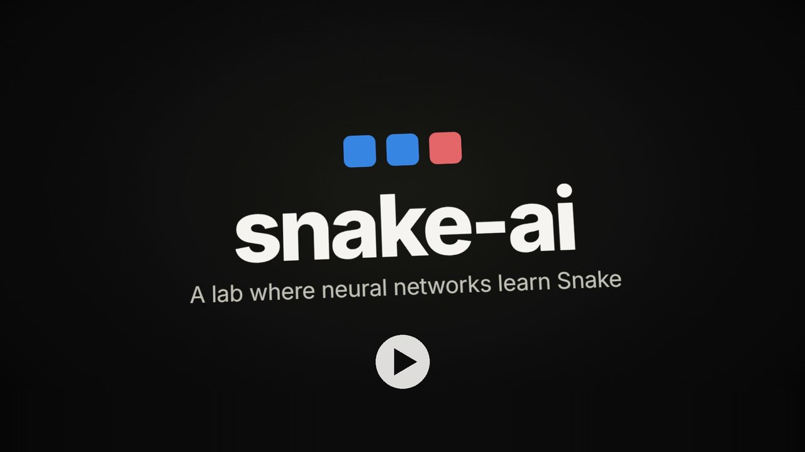
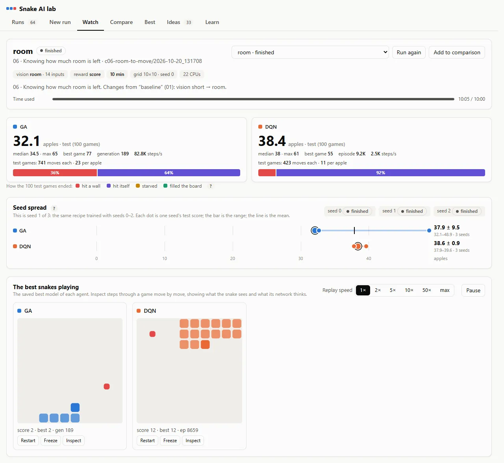
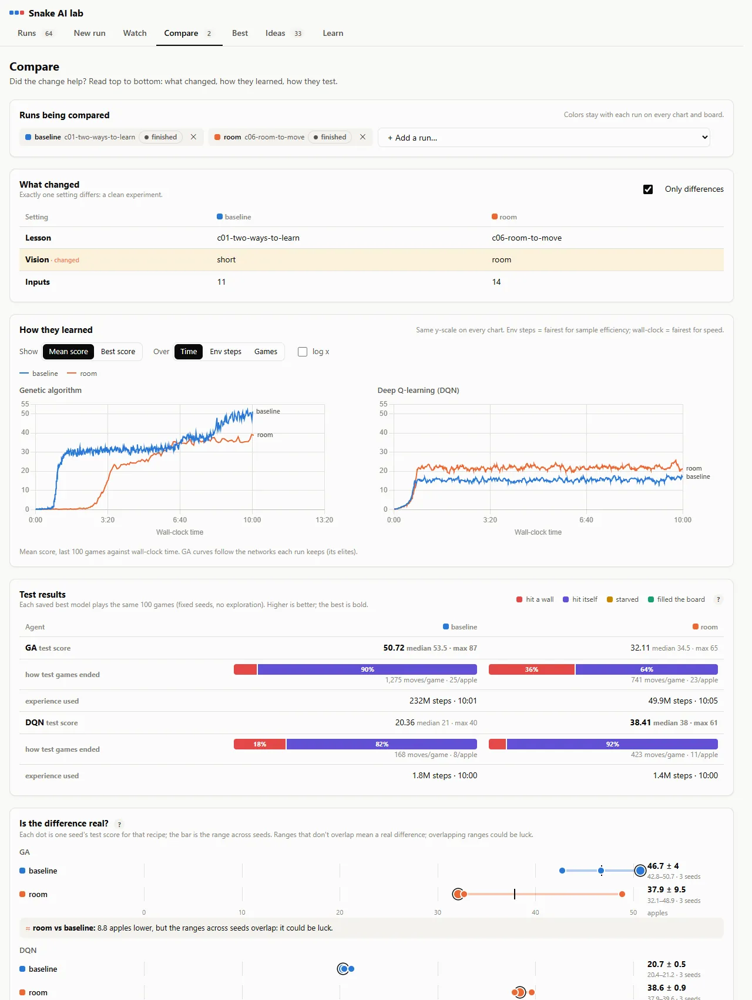
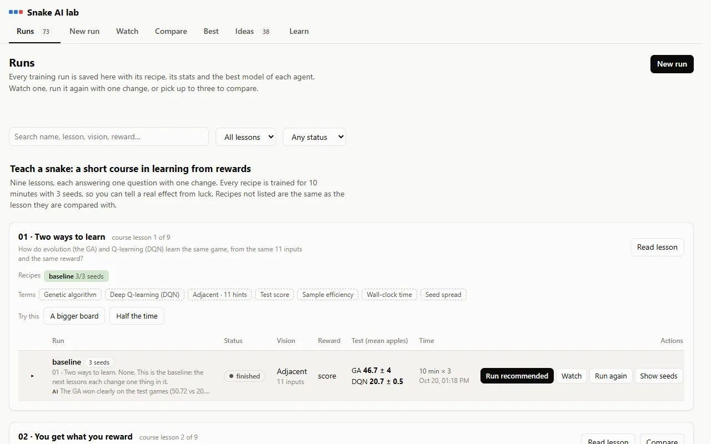
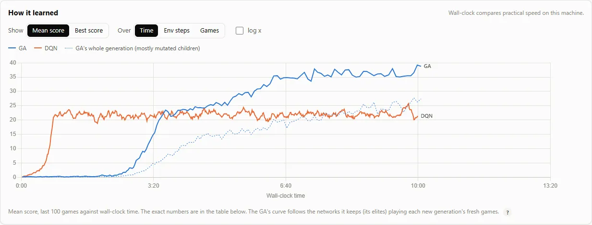
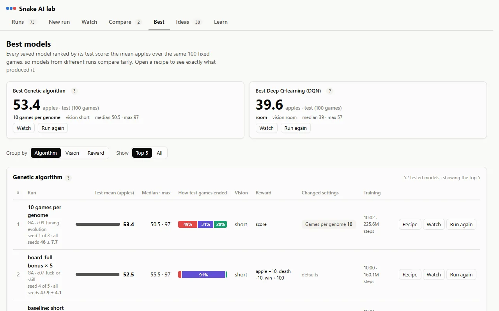
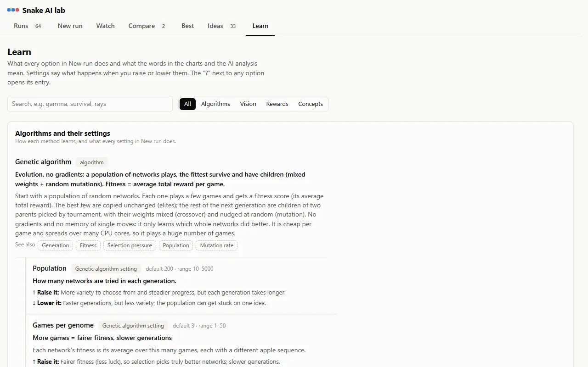
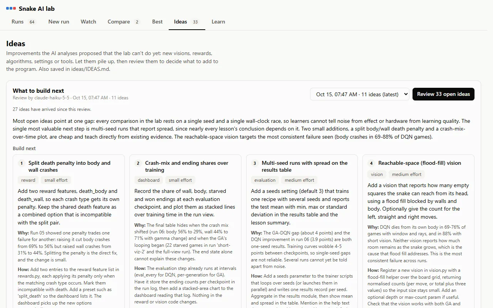
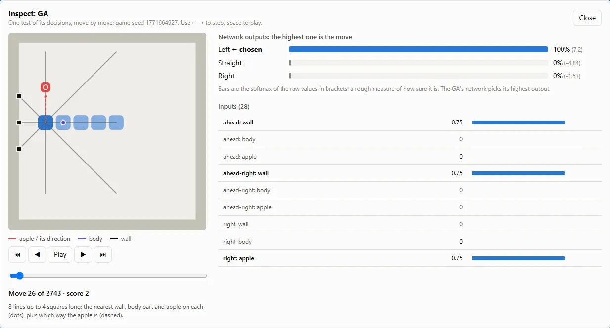

# snake-ai

[](https://github.com/markmysler/snake-ai/actions/workflows/ci.yml)
[](LICENSE)
[](https://markmysler.github.io/snake-ai/)
[](https://youtu.be/1bu1y4cJJmA)

A learning project and a small lab: neural networks learn to play Snake, and you can watch them do it. You decide what each snake **sees**, how it is **rewarded**, and which **algorithm** learns. Every run is saved with its exact recipe, so anyone can repeat it, change one thing, and compare.

**Try it without installing anything:** the [live demo](https://markmysler.github.io/snake-ai/) has the whole trained
course: watch the snakes, inspect their games move by move, compare runs and read the lessons (read-only).

<p align="center"></p>

- **Two training algorithms:** a genetic algorithm (evolution, numpy) and Deep Q-learning (PyTorch), with an MLP or a small
  CNN for the picture visions.
- **A third player that never trains:** jev, TypeSafe's decision model, plays from a text description of what the snake
  senses (optional, paid per move, through TokenRouter).
- **Five visions:**
  - the 11 hints from lesson 01;
  - rays that look *N* squares ahead;
  - a square window around the head;
  - the whole board;
  - the 11 hints plus *room to move*: how much of the board each move keeps reachable.
- **Ten reward features to mix:** apple, death (or separate wall and body crash penalties), starvation, board-full, distance hint, potential-based hint, hunger, survival. Conflicting ones are blocked.
- **A browser dashboard** to launch, watch, browse, delete and compare runs, live.
- **Inspect mode:** step through any game move by move and see what the snake saw (drawn on the board, plus the raw inputs) and how strongly its network preferred each move.
- **A nine-lesson course** (`course.py`): one question and one change per lesson, every recipe trained with 3 seeds, with exercises to try next.
- **Adapts to any machine:** it measures CPU cores and RAM and plans each run's workers, threads and memory to fit.
- **AI analysis (optional):** an LLM explains what a run did and why, writes it into the lesson, and suggests next runs. The recommended run starts with one click. Ideas that need new code are collected in an Ideas list and reviewed together.

## The explainer video

New here? This four-minute video shows what a snake sees, how evolution and Q-learning learn from it, and what the
course found.

<p align="center"><a href="https://youtu.be/1bu1y4cJJmA"></a></p>

## First 15 minutes

1. **Start the lab.** Install it (below), then run `python run_all.py --dashboard-only`. The dashboard opens in your browser.
2. **Watch the baseline.** In **Runs**, find *01 · Short vision (the baseline)* in the Notebook and press **Watch**. Three snakes
   trained for 10 minutes play their saved best models. Press **Inspect** under a board: step with ← → and see the three danger
   hints and the apple direction it gets, and how sure its network is of each move.
3. **Change one thing.** Press **Run again**, pick the vision *Adjacent + room to move*, set the training time to 3 minutes and
   press **Start training**. Write down your prediction first: will knowing how much room each move leaves help?
4. **Compare.** When it has finished and been tested (about 4 minutes), tick both runs in **Runs** and press **Compare**.
   *What changed* should list the vision (and the time). *Is the difference real?* says what one seed each can and can't tell you.
   That is why every course lesson trains its recipes with 3 seeds.
5. **Optional: ask the AI.** With an API key in `.env` (see below), press **Analyze this run** in Watch: it explains what
   happened and suggests the next run, which starts with one click.

Then work through the course: **Runs → 01 · Two ways to learn → Train this lesson**, one lesson at a time, or the whole
course overnight with `python course.py run all --wait`.

## Install

Python 3.10+ on Windows, Linux or macOS. Continuous integration runs the tests on Linux, Windows and macOS with Python 3.10
and 3.13, and in the Docker image.

```bash
git clone https://github.com/markmysler/snake-ai.git && cd snake-ai
# CPU-only PyTorch is much smaller than the default build and is all this project needs:
pip install torch --index-url https://download.pytorch.org/whl/cpu --extra-index-url https://pypi.org/simple
pip install -r requirements.txt
```

Or with Docker (no Python needed on the machine):

```bash
docker build -t snake-ai .
docker run --rm -p 8000:8000 -v "$PWD/lessons:/app/lessons" -v "$PWD/ideas:/app/ideas" snake-ai
# open http://localhost:8000; add --env-file .env for the AI analysis, --cpus=4 --memory=6g to limit it
docker run --rm snake-ai python -m pytest -q tests      # the tests
```

The volumes keep runs and ideas on your disk. Inside a container the planner uses the container's CPU and memory limits.

The JavaScript libraries (Chart.js, marked) are vendored in `dashboard/static/vendor/`, so everything works offline.

For the AI analysis, copy `.env.example` to `.env` in this folder and add an API key for **TokenRouter**
(`TOKENROUTER_API_KEY`) or **OpenRouter** (`OPENROUTER_API_KEY`). With both, TokenRouter is used unless
`SNAKE_AI_LLM_PROVIDER=openrouter`. The default model is `anthropic/claude-haiku-5.5` on either (set `SNAKE_AI_LLM_MODEL`
for another). Any other OpenAI-compatible API works too: set `TOKENROUTER_BASE_URL` and `TOKENROUTER_API_KEY` to it.
`python llm.py` checks the setup with a tiny request. `.env` is git-ignored. Everything else works without it.

## Quick start

```bash
python run_all.py --dashboard-only     # open the lab, then use "New run" in the page
python run_all.py                      # or: start a run right away (GA + DQN, short vision, 10 min)
python run_all.py --lesson 03-rays --vision rays:depth=4 --reward shaped --time-budget 10
```

The dashboard opens at <http://127.0.0.1:8000/>; if that port is busy it moves to the next free one. Ctrl+C stops the run early, still evaluates and saves it, then closes the dashboard.

## The dashboard

<picture><source media="(prefers-color-scheme: dark)" srcset="docs/img/watch-dark.webp"></picture>

Seven tabs, each answering one question.

| Tab | Question | What's on it |
|---|---|---|
| **Runs** | What have we tried? | Runs training now (progress, Stop & save) · this machine and how many runs may train at once · every saved run grouped by lesson, with search and filters · per run: Watch, Run again, Edit (name / note / lesson), Delete · tick up to 3 runs to compare · "Read lesson" opens the lesson write-up |
| **New run** | What do I want to test? | 1 lesson + your prediction · 2 algorithms (with advanced settings) · 3 vision (with its settings and input count) · 4 reward features (presets; conflicting features are disabled with the reason) · 5 time, board size, seed. The side panel shows the recipe, the CPU and memory plan for this machine, and any warnings. "Run again" opens an old run's recipe here. |
| **Watch** | How is one run doing? | A headline number per agent (test score once evaluated, otherwise the live mean of the last 100 games), with **how its test games ended** (hit a wall / hit itself / starved / filled the board) and moves per game and per apple · **Seed spread** for a run trained with several seeds (each seed's test score as a dot) · **AI analysis** of finished runs (headline, what we learned, what happened and why, 2–3 recommended next runs with Launch / Edit first) · the best snakes playing, with speed / pause / restart / freeze controls · **Inspect** any game move by move (below) · one learning-curve chart (mean or best score over time, env steps or games; log x) · collapsible: GA population (16 genomes at once), a numbers table, the full recipe |
| **Compare** | Did the change help? | Up to 3 runs, each with a fixed color · **What changed**: settings that differ, highlighted (one difference = a clean experiment) · **How they learned**: one chart per algorithm, all on the same y-scale · **Test results**: 100 fixed games per saved model, best in bold, and how those games ended · **Is the difference real?**: each recipe's test score across its seeds on one axis, with a verdict (ranges that don't overlap = a real difference; overlapping = could be luck; a single seed = can't tell, or *likely real* when it lies far outside the other recipe's spread) · optional side-by-side games |
| **Best** | What has worked best so far? | The best saved model of each algorithm as headline tiles · ranked tables of every tested model (group by algorithm, vision or reward), with test score bars on one shared scale · **Recipe** opens the exact settings that produced a model, with non-default settings in bold · Watch / Run again |
| **Ideas** | What should the lab be able to do next? | Every improvement an AI analysis proposed that needs new code (a new vision, reward, algorithm, setting, chart or tool), from all runs · **Review** asks the LLM which to build next: it merges duplicates, ranks them by evidence and effort, and says how to build each one · mark ideas planned, done or dismissed · earlier reviews are kept |
| **Learn** | What does this setting or word mean? | A glossary of every algorithm, setting, vision and reward feature, plus general terms (epsilon, fitness, sample efficiency…) · each setting says what raising or lowering it does · searchable. The **?** next to every option in New run and Best opens its entry, and every AI recommendation lists the terms it uses |

| | |
|---|---|
| <picture><source media="(prefers-color-scheme: dark)" srcset="docs/img/compare-dark.webp"></picture> | <picture><source media="(prefers-color-scheme: dark)" srcset="docs/img/runs-dark.webp"></picture> |
| <picture><source media="(prefers-color-scheme: dark)" srcset="docs/img/learning-dark.webp"></picture> | <picture><source media="(prefers-color-scheme: dark)" srcset="docs/img/best-dark.webp"></picture> |
| <picture><source media="(prefers-color-scheme: dark)" srcset="docs/img/learn-dark.webp"></picture> | <picture><source media="(prefers-color-scheme: dark)" srcset="docs/img/ideas-dark.webp"></picture> |

### Inspect: what the snake sees

<picture><source media="(prefers-color-scheme: dark)" srcset="docs/img/inspect-dark.webp"></picture>

Press **Inspect** under any board in Watch to step through that game (it is replayed exactly from its seed and the model
version). For every move you see:
- **what the vision looks at, drawn on the board:** the danger arrows and apple direction of `short`, the 8 rays of `rays`
  with what each one hit, the box of `window`, each move's reachable pocket of `room` with its share. A band around the
  board stands for the wall;
- **how much the network preferred each move:** the GA's three outputs or DQN's Q-values, as shares (softmax) with the raw
  numbers, and the move it chose;
- **the inputs themselves:** a named list for the small visions, or the pictures the network gets for `window` and `full`
  (centred on the head and turned so the snake faces up).

Use ← → (or the slider) to step, space to play, Home / End for the first and last move. The last move shows how the game ended.

How the design follows data-viz practice:
- Controls sit in one row above the charts they affect.
- Headline numbers come before charts.
- Comparisons use one chart per algorithm with a shared scale instead of one crowded chart.
- Color always means the same thing: the agent in Watch, the run in Compare. It's capped at 3 runs so the colors stay distinguishable, including for color-blind viewers.
- One tooltip lists every line at the hovered position, and lines carry labels at their ends.
- Every chart has a table equivalent.
- Light and dark themes follow your system.

Notes:
- **Training and viewing are decoupled.** The boards replay saved weights in the dashboard process. Training runs in separate processes at full speed whatever the replay speed, and keeps going if you close the dashboard. Boards in collapsed sections don't play at all.
- **Boards switch models only between games**, so behaviour never changes mid-game.
- **Which x-axis to use:** *Env steps* is the fairest comparison of **sample efficiency** (how much experience each method needed). *Wall-clock* is the fairest for **practical speed** on this machine.
- **Wall-clock results depend on the machine.** Laptops on battery are throttled, and parallel runs share cores. Every run records the CPU count, power state and how many runs shared the machine, and Compare shows them.

## Building a run (the recipe)

A run's recipe (see `runconfig.py`) is what gets saved and repeated:

```json
{"lesson": "03-rays", "name": "rays 4", "note": "prediction…",
 "vision": {"type": "rays", "depth": 4},
 "reward": {"apple": 10, "death": 10, "hunger": 0.01},
 "agents": [{"id": "ga", "algorithm": "ga", "params": {"population": 200, "...": "..."}},
            {"id": "dqn", "algorithm": "dqn", "params": {"lr": 0.001, "...": "..."}}],
 "time_budget_min": 10, "width": 10, "height": 10, "seed": 0}
```

### Visions (`vision.py`)

| Spec | Inputs (10×10) | What it sees |
|---|---|---|
| `short` | 11 | danger in the next square straight/left/right, heading, food direction (lesson 01) |
| `room` | 14 | the 11 hints, plus for each move the share of the free board still reachable after it (a flood fill). A move into a pocket scores low while it is still safe |
| `rays:depth=N` | 28 | along 8 lines around its heading: how close the nearest wall, body part and apple are within N squares, plus food direction |
| `window:radius=N` | 3·(2N+1)²+4 | a picture of the squares within N steps of the head, rotated so the snake faces up, plus food direction |
| `full` | 1,083 | the whole board as pictures centred on the head, rotated so the snake faces up (lesson 02) |

### Reward features (`rewards.py`)

| Feature | Default | When | Can't combine with |
|---|---|---|---|
| `apple` | +10 | each apple | |
| `death` | −10 | crash into wall or body | `death_wall`, `death_body` |
| `death_wall` | −10 | crash into a wall | `death` |
| `death_body` | −10 | crash into its own body | `death` |
| `starve` | −10 | the game ends after 100 × length moves without eating | |
| `win` | +100 | board filled | |
| `distance` | ±0.1 | each move closer / farther | `potential` |
| `potential` | γΦ(after) − Φ(before), Φ = −w·distance | each move | `distance` |
| `hunger` | −0.01 | each move | `survival` |
| `survival` | +0.1 | each move | `hunger` |

Presets:
- `score` = apple + death.
- `shaped` = score + distance.
- `ga_classic` = apple×100 + survival 0.1. This is the GA fitness from lessons 01–02.
- `split_death` = apple + wall crash −10 + body crash −30 + starving −30. Starving costs as much as the worst crash; otherwise looping until it starves becomes the safe way out, and the New run form warns about it.

The GA uses the same reward as the DQN: its fitness is a genome's average total reward per game. With the plain `score` reward the GA starts slowly: early on almost every genome scores −10, so selection has little to choose between until a few genomes stumble onto apples. A survival or distance signal speeds that up (and lesson 02 of the course shows what a survival bonus costs).

### Algorithms (`algorithms.py`)

- **`ga`:** population, games per genome, elite fraction, tournament size, mutation rate and size. Parallel worker processes.
- **`dqn`:** learning rate, gamma, batch, replay buffer, exploration decay, target sync, parallel games, evaluation interval,
  and the **network**: an MLP, or a small **CNN** (three 3×3 convolution layers) that reads the `window` and `full` pictures
  as images. Uses torch threads.
- **`jev`:** TypeSafe's decision model (`jev.py`, `train_jev.py`). It doesn't learn: each move it gets what the snake
  senses as text (said relative to its heading, or the pictures as small character grids) and picks left, straight or
  right with a probability for each. So a jev run has no training phase; it plays the fixed test games itself, up to 100
  boards per request. Settings: test games (default 20), **instructions** (its only "training": *Just the rules* or
  *Rules + stay safe*), boards per request, and a spending cap. It needs `TOKENROUTER_API_KEY`; New run shows the
  estimated cost (about $0.03 for 20 games) and asks before starting. Its moves and probabilities are saved, so Watch
  and Inspect replay its games without calling it again. Its test score covers fewer games than the others' 100, and the
  dashboard says so.

### How a run uses the machine (`system.py`)

`python system.py` prints what was detected: CPU cores (respecting affinity and container limits), total and free RAM, and power state. It reads these with each OS's own calls, so no extra package is needed.

For each run, `system.plan()` decides resources:
- When DQNs run alongside, GA worker pools get half the cores. Each DQN gets one torch thread.
- Memory is estimated per agent (DQN replay buffers dominate). If the run doesn't fit in 80% of free RAM, buffers shrink first, then worker pools, with a warning.
- It reports how many runs like this could train at once.

The **Runs** tab sets how many runs may train at the same time. Extra runs wait in a queue, and each running run gets its share of the machine. You can override any agent's cores in the New run form.

## Is it real? Test games and seeds

**How test games ended.** Every saved model plays the same 100 fixed-seed games. Each game is recorded: its score, its moves, and
how it ended: hit a wall, hit itself, starved (100 × length moves without eating) or filled the board.
- Mostly *hit itself* means the snake eats well but traps itself as it grows.
- Mostly *starved* means it learned to wander instead of eat.

Moves per apple tell the same story: around 10 is efficient, hundreds means wandering. Runs recorded before this existed were
backfilled with `python lessons.py backfill`. Because the test games use fixed seeds, every model reproduced its stored scores exactly.

**How training games ended.** The trainers also record how their last 100 *training* games ended at every stats row. Watch charts the shares over time, one small chart per agent, so you can see *when* the mix shifts: starving creeping up when a reward pays for wandering, or body crashes taking over as the snake grows. DQN's training games include its random exploration moves, so they differ from the test games. Runs recorded before this was added don't have it.

**The GA's curve follows the networks it keeps.** Each generation is mostly mutated children, and most mutations make a
network worse. So the GA's training mean (and its endings chart) follows its *elites*: the networks it carries unchanged into
the next generation, scored on that generation's new games. Scoring them on the games they were picked on would overstate them
(the *winner's curse*). The whole generation is recorded too (`pop_mean_score`, `pop_end_*` in the CSV) and drawn as a thin
dotted line; the endings chart has a *Kept networks / Whole generation* switch. Runs recorded before this change only have the
last ~33 children of each generation, which made the GA look worse and starve more than the networks it kept; Watch and
Compare say so and draw those curves dashed.

**Seeds.** One run is one seed, and a different seed can give a noticeably different score. Set **Seeds** in New run (or `--seeds N`)
to train the recipe N times with seeds *seed, seed+1, …*: a **seed group**.
- **Runs:** the group is one row showing *mean ± standard deviation*; expand it to see each seed.
- **Watch:** a run in a group shows where its score sits among the others.
- **Compare:** the two recipes' spreads go on one axis, with a verdict.
- **AI analysis:** a group is analysed once, when its last run finishes, using the whole spread.
- **Recommendations:** a run launched from a group's analysis gets the same number of seeds.

The queue trains as many runs at once as the Runs tab allows. Raise it to finish a group sooner, but runs then share the CPU, so
wall-clock speed is not comparable with runs trained alone.

## Sharing a read-only demo

```bash
python -m dashboard.server --read-only --host 0.0.0.0 --port 8000
docker run --rm -p 8000:8000 snake-ai python -m dashboard.server --read-only --host 0.0.0.0 --port 8000
```

Everyone can browse the runs and lessons, watch the snakes, inspect games, compare runs and read the glossary, but the
server refuses anything that changes the lab (launching, editing, deleting, analysing, training the course) with 403, and
the dashboard hides those buttons and this machine's details. A good way to share the trained course, e.g. on a small
server or a Hugging Face Space.

**Without a server** (GitHub Pages, Vercel, Netlify, any static host):

```bash
python tools/export_site.py            # writes site/: the dashboard + the server's answers as files (~45 MB)
python -m http.server -d site 8080     # try it: http://127.0.0.1:8080
npx vercel deploy site --prod          # e.g. on Vercel (or drag site/ onto Netlify)
```

The export asks the real read-only server for every answer, so the site shows the same thing. What the server would
compute on demand is computed once: each snake gets three replay games with fixed seeds, recorded move by move for
Inspect (gzipped; the browser unpacks them). The [live demo](https://markmysler.github.io/snake-ai/) is built this way by
`.github/workflows/pages.yml` on every push to `main` (one-time setup: *Settings > Pages > Source: GitHub Actions*).

## Lessons: the course and the notebook

[`lessons/`](lessons/README.md) is where all of it is kept. Each lesson asks one question. It holds:
- a write-up (`LESSON.md`);
- every run (`runs/<id>/`, with `run.json`, the stats CSVs, the best model of each agent, and logs).

The Results block in each `LESSON.md` and the index in `lessons/README.md` are regenerated automatically. Everything else in `LESSON.md` is yours.

**The course** ([`lessons/course.json`](lessons/course.json), `course.py`) is the path for learners: nine lessons, each with one
question and one change, every recipe trained for 10 minutes with 3 seeds (5 for *Luck or skill?*).

| # | Question | The one change |
|---|---|---|
| 01 | How do evolution and Q-learning learn the same game? | baseline: short vision, `score` reward |
| 02 | You get what you reward | + a survival bonus |
| 03 | Can hints speed learning up safely? | DQN: no hint vs distance vs potential-based hint |
| 04 | Does seeing further help? | rays 4 and rays 9 instead of short |
| 05 | Is more information always better? | the whole board instead of rays 4 |
| 06 | Knowing how much room is left | room instead of short |
| 07 | Luck or skill? | 5 seeds, then a bonus that can't matter |
| 08 | How far ahead to plan | DQN gamma 0.99 instead of 0.95 |
| 09 | Tuning evolution | GA: 10 games per genome, or mutation rate 0.05 |

Each lesson's `LESSON.md` starts with a block generated from `course.json` (links to the previous and next lesson, the
question, the change, a prediction prompt, background, what to watch, its recipes and what each changes, and glossary
terms) and ends with **Try this** exercises. In between are the generated results (with the seed spread and how the games
ended), the AI analysis of each seed group when an API key is set, and **What we learned**, which is yours to write.

In **Runs**, the course comes first: each lesson shows its question, which recipes are trained (seeds done of 3), its terms,
**Train this lesson** (queues the missing recipes), **Compare** (its recipes and what they change from, with the seed-spread
verdict) and its **Try this** exercises, which open in New run.

```bash
python course.py list                          # what is trained so far
python course.py run 4                         # queue lesson 4 (the dashboard trains it)
python course.py run all --wait --parallel 2   # train the whole course here, 2 runs at a time (about 4 hours)
python course.py check                         # what is missing: runs, "What we learned", one-change recipes
python course.py write                         # rewrite the generated blocks after editing course.json
```

The whole course is 49 runs of 10 minutes: about 8 hours one at a time. Each run records how many runs shared the
machine, and the course uses one setting for all its runs, so wall-clock comparisons stay fair.

**The notebook** is every other lesson: your own, and the experiments that came before the course (several were its pilots).
1. **01 · Short vision:** the baseline. How the GA and DQN learn.
2. **02 · Full vision:** more information isn't free. DQN learned just as well per step but ran 5× slower; the GA learned much worse.
3. **10 · A CNN for the whole board:** per env step a small CNN learns as well as the MLP, but each step is several times
   slower, so in 10 minutes it loses (26.1 test apples with 4 threads, against 31.5 for the MLP with one).
4. **11 · jev without practice:** with no training, TypeSafe's decision model scored 26.6 test apples on 5 games, about
   what DQN reaches after 10 minutes on the same vision, for under 2 cents.

How to run your own experiment:
1. **New run** → pick or create a lesson, and write your **prediction** first.
2. Change **one** setting from an earlier run. "Run again" copies a recipe for this.
3. Watch it, then compare it with the earlier run. "What changed" should show exactly one difference.
4. Write what you learned in the lesson's `LESSON.md`.


**Sharing your lessons.** A run records only the machine facts needed to judge its results: CPU count, battery or mains,
how many runs shared the machine, and the cores and settings each agent actually used. It records nothing that identifies
the machine (no paths, user name, OS build or RAM). Runs recorded by older versions can be cleaned with
`python lessons.py scrub`. Trainer logs (`runs/*/logs/`) do contain local paths; they are git-ignored.
## AI analysis (`analysis.py`, `llm.py`)

Press **Analyze this run** on a finished run in Watch, or tick **Analyze with AI when it ends** in New run (`--analyze` on the command line).

What the model is given (about 9k tokens):
- the run's recipe, learning curves and test results;
- the lesson's write-up;
- the other recorded runs;
- the catalog of every vision, reward feature and algorithm setting.

What it answers:
- a headline;
- what each agent achieved;
- why;
- what a learner should take away;
- whether your prediction held;
- **next runs:** 2–3 recipe changes the lab can run today, each changing one setting. The first one is the *recommended* run;
- **ideas:** improvements that would need new code. These go to the Ideas list, not into a run.

**Recommendations are checked, not trusted.** Each recommended recipe is rebuilt from this run's recipe and validated exactly like the New run form. The change chips ("vision rays:depth=4 → rays:depth=9") are computed from the two recipes, not copied from the model's text. A recipe that doesn't validate shows its error and can't be launched.

**One click.** In **Runs**, an analysed run has a **Run recommended** button that queues its recommended run. Its tooltip shows the change and the prediction, and once the run is launched the button becomes **Next run →**. In Watch, every next run has **Launch**, which queues the run as recommended, with the recommendation's title as its name and its prediction as its note. If it asks a new question, Launch creates the next numbered lesson with its Question, Change and Prediction already written. **Edit first** opens it in New run.

**Where it is kept:**
- `runs/<id>/analysis.json` holds the full analysis.
- An "AI analysis" block in the lesson's `LESSON.md` is regenerated like the Results block, so your own text is never touched.
- A run launched from a recommendation links back to the run that suggested it.

AI analyses can be wrong: they cite the numbers, so check them against the charts.

### Ideas (`ideas.py`)

An analysis keeps two kinds of advice apart:
- **Recipe changes** can be launched now.
- **Ideas** need new code: a vision, reward feature, algorithm, setting, training feature, evaluation or dashboard view the lab doesn't have yet.

A recipe the model suggests that fails validation is not lost: it becomes an idea, with the reason it can't run yet.

Ideas from every analysed run collect in `ideas/` (`ideas.json`, plus a readable `IDEAS.md`). Re-analysing a run replaces only its ideas that are still *new*, and idea ids are never reused.

Let them pile up, then press **Review** in the Ideas tab (or run `python ideas.py review`). The LLM gets:
- every open idea;
- what the lab can already do;
- the best results so far.

It answers with:
- **Build next:** up to 5 items, merged and ranked by value per effort. Each says what to build, why, how to build it in this code base, and the first experiment to run once it exists.
- **Later**, and **Not worth it**, each with its reasons.

Reviewed ideas are marked *reviewed*. Mark them *planned*, *done* or *dismissed* as you decide. Every review is archived in `ideas/reviews/`, and a failed review keeps the last good one.

## Command line

```bash
python run_all.py [--dashboard-only] [recipe flags] [--parallel N] [--exit-when-done] [--no-browser]
python -m dashboard.server [--port 8000] [--parallel N] [--read-only]   # the lab on its own
python experiment.py --lesson 03-x --vision window:radius=2 --reward score --agents ga,dqn --time-budget 10
python experiment.py --config recipe.json                   # a recipe as JSON
python experiment.py --stop <lesson>/<run-id>               # stop a running run (it is still evaluated and saved)
python lessons.py list | evaluate <id> | delete <id> | index | backfill | scrub | import <lesson> --vision short --agents dqn
python evaluate.py lessons/01-short-vision/runs/<id>/models/*   # 100 fixed-seed games, any vision
python train_ga.py --vision rays:depth=4 --reward shaped --generations 50   # a trainer on its own
python train_dqn.py --vision full --reward score --episodes 2000 [--net conv] # (writes results/ + models/)
python train_jev.py --vision short --games 20 --prompt careful               # jev plays 20 test games (paid)
python analysis.py run <lesson>/<run-id>                    # AI analysis of a finished run (needs .env)
python analysis.py show <lesson>/<run-id>                   # print it
python analysis.py launch <lesson>/<run-id> 1               # queue recommendation 1 (the dashboard starts it)
python ideas.py list | review | status <idea-id> planned   # the ideas list and its AI review
python course.py list | run <n>|all [--wait] [--parallel N] | check | write   # the course (also: python lessons.py course ...)
python tools/screenshots.py [--channel msedge]              # re-shoot the README images (pip install -r requirements-dev.txt)
python llm.py                                               # check the LLM settings with a tiny request
python system.py                                            # what this machine has
python -m pytest -s tests/                                  # env, visions, rewards, library, API tests
```

Recipe flags (shared by `run_all.py` and `experiment.py`): `--lesson --name --note --vision --reward --agents --time-budget --seed --width --height --config`, plus `--analyze` and `--seeds N`.

## Extending it

The command line, the recipe and the New run form all read from the same registries, so an addition shows up everywhere at once.

**A new vision** (`vision.py`):
1. Write `view(env, **params)` returning a float32 array with values in [0, 1], plus `size(width, height, **params)`.
2. Call `register(Vision(name, label, description, view, size, [int_param(...)]))`.
3. Optional, for Inspect: `explain=` (drawing primitives in board squares: shaded cells, lines, marks, boxes and one
   sentence), and `names=` (one name per input) or `picture=` (how the inputs form pictures). See `EXPLAIN` in `vision.py`.

**A new reward feature** (`rewards.py`):
1. Add it to `FEATURES`, with `incompatible` if it conflicts with another feature.
2. Handle it in `Rewarder.__call__`.

**A new algorithm** (`algorithms.py`):
1. Write a trainer script that:
   - accepts the common flags (`--agent --vision --reward --seed --width --height --time-budget --live-dir --results-dir --models-dir`) plus its own;
   - publishes with `publisher.Publisher`;
   - saves `models/<agent>_best.<ext>` (`train_dqn.py` is a good template).
2. Register it with its settings, resource flag and memory estimate.
3. If its model format is new, teach `policies.load_policy` to load it.

Anything you add to a registry also gets a **glossary** entry in the Learn tab automatically, built from its description and help text. For a fuller explanation, add it to `EXTRA` in `glossary.py`, including what raising or lowering a setting does.

## How it fits together

```
dashboard (FastAPI) ──queue──> experiment.py ──> train_ga.py / train_dqn.py (one process per agent)
     ▲   SSE + /api/game               │                     │ publish (atomic writes)
     │                                 ▼                     ▼
     └── reads ── lessons/<lesson>/runs/<id>/{run.json, results/, models/, logs/}  +  temp live/ folder
```

| File | Role |
|---|---|
| `snake_env.py` | headless Snake: `reset()`, `step()`, seeds, stall limit; uses a vision and a reward |
| `vision.py`, `rewards.py`, `algorithms.py` | the registries: what a snake can see, be rewarded for, and learn with |
| `runconfig.py` | the recipe: normalize, validate, describe, build trainer command lines |
| `system.py` | detect CPU cores, RAM and battery; plan a run's resources |
| `experiment.py` | run one recipe: start trainers, enforce time, honour stop requests, evaluate, record |
| `lessons.py` | the run library: create, list, edit, move, delete, evaluate runs; regenerate `LESSON.md` and the index |
| `course.py` | the course: `lessons/course.json` in order, queueing its recipes as seed groups, generating its `LESSON.md` blocks, checking what is missing |
| `publisher.py` | trainers' live output: atomic writes, stats CSV, stop file |
| `train_ga.py`, `train_dqn.py`, `policies.py`, `dqn_model.py` | the algorithms and their models (MLP and CNN Q-networks) |
| `jev.py`, `train_jev.py` | jev as a player: what the snake senses in words, batched decisions, recorded games |
| `evaluate.py` | 100 fixed-seed games for any saved model: score, moves and how each game ended |
| `glossary.py` | the Learn tab: an entry for every algorithm, setting, vision and reward feature (from the registries) plus general terms |
| `ideas.py` | the ideas list: improvements that need new code, collected from every analysis, and the AI review of what to build next |
| `analysis.py`, `llm.py` | AI analysis: build the run's context, ask the LLM, check its recommended recipes, launch one, write the lesson; a tiny OpenAI-compatible client (TokenRouter or OpenRouter) that reads `.env` |
| `dashboard/server.py`, `hub.py`, `jobs.py`, `store.py`, `replay.py`, `inspector.py` | API + SSE, run list and watchers, the run queue, live/saved weights, compact replay games, Inspect's move-by-move frames |
| `dashboard/static/` | plain HTML + canvas + Chart.js: `app.js` (tabs), `views/` (runs, new run, watch, compare, best, ideas, learn), `components/` (board, inspector, line chart, endings chart, seed spread, glossary, playback, population) |
| `tools/screenshots.py` | the README images, re-shot from the running dashboard |
| `tools/export_site.py` | the read-only demo as a static site (GitHub Pages, Vercel...) |
| `.github/workflows/ci.yml` | tests on Linux, Windows and macOS (Python 3.10 and 3.13) and in the Docker image |

## Roadmap

Plans for what comes next (fairer GA vs DQN comparisons at equal compute, playing it yourself) are in [docs/ROADMAP.md](docs/ROADMAP.md).

## Contributing

Issues and pull requests are welcome. See [CONTRIBUTING.md](CONTRIBUTING.md) for the set-up, the tests and what makes a
good lesson.

## License

MIT, see [LICENSE](LICENSE). Chart.js and marked (vendored in `dashboard/static/vendor/`) are MIT-licensed too.
